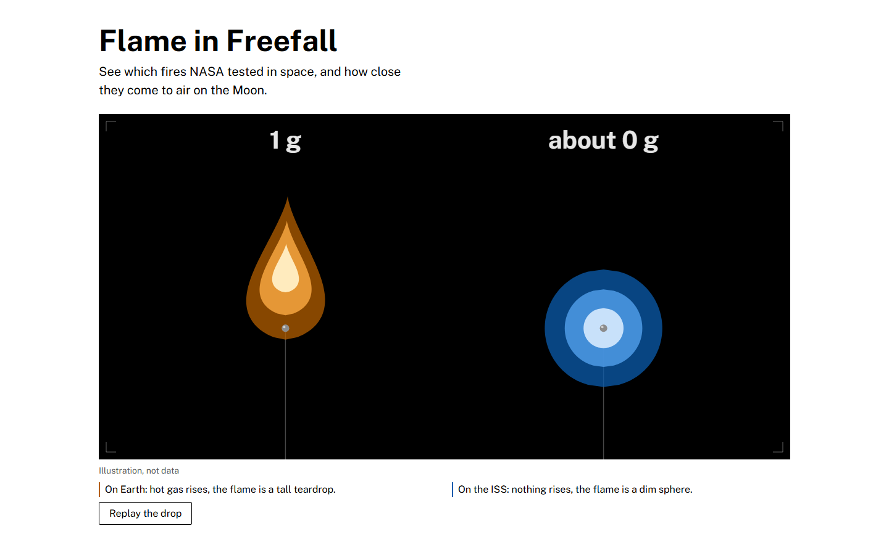
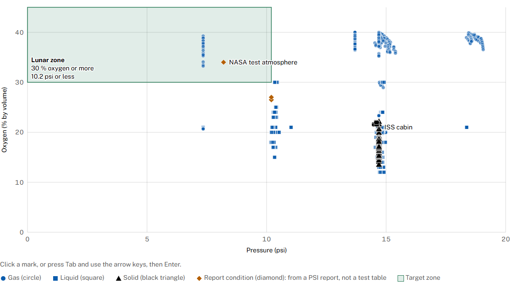
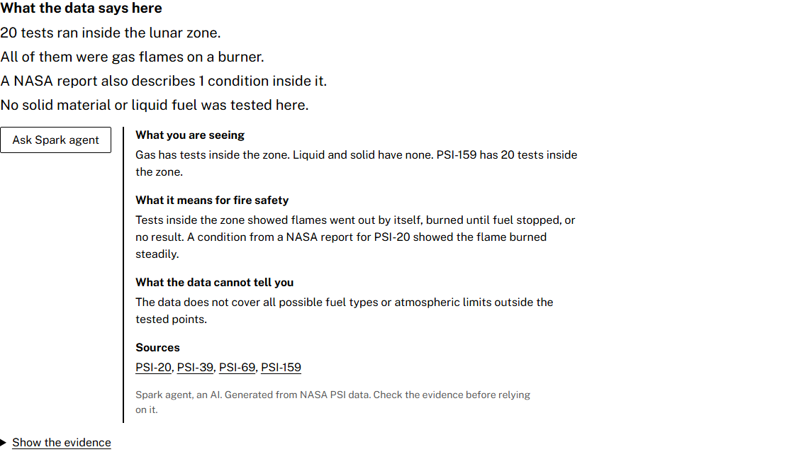
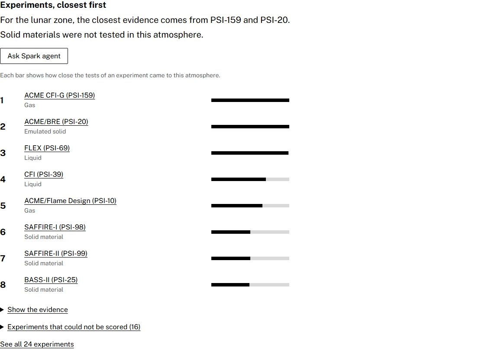

# Spark: Flame in Freefall

A web dashboard for the NASA Space Apps 2026 challenge "Flame in Freefall", built by team Neural Spark.

## What the site does

Spark puts the microgravity fire experiments that NASA ran on the International Space Station on one map of oxygen against pressure. You pick an atmosphere (the ISS cabin, a lunar base, or your own numbers) and the site shows which tests came closest to it, what the flames did, and which kinds of material have no test there. Every number comes from NASA's PSI records or NASA's reports, every block can show its evidence, and an AI helper called Spark agent can explain any block in plain words.

In the NASA data we loaded, no solid material was tested inside the lunar zone. The site computes that from the data. It is not typed into the page.

## Screenshots


The front page. The flame animation is an illustration, not data.


The atmosphere map. Black triangles are tests on solid material. They only appear near the pressure of the ISS cabin.


The plain sentences come from the data. Spark agent explains the same block and cites its sources.


The experiments, closest first. Each one opens a page with its record from NASA.

## Run it locally

You need Git, [uv](https://docs.astral.sh/uv/) (it installs Python 3.12 for you) and Node.js with npm. We built and tested it with Node v24.20.0 and uv 0.13.1.

```
git clone https://github.com/aunraza19/Spark.git
cd Spark
uv sync
cd web
npm install
npm run build
cd ..
```

Then start the site:

```
uv run uvicorn --factory spark_data.api:create_app --port 8000
```

Open http://localhost:8000. The server serves the data and the built page together.

**Spark agent is optional.** It works with either of two Google Gemini setups. Copy `.env.example` to `.env` (`cp .env.example .env`, or `copy .env.example .env` on Windows) and fill in one of them. The `.env` file is ignored by git.

- **A free Google AI Studio key** (the simplest way for anyone running the site). Get a key at https://aistudio.google.com/ and put it in `GEMINI_API_KEY`. Nothing else is needed. This is the default.
- **Vertex AI.** Set `SPARK_GEMINI_BACKEND=vertex`, set `GOOGLE_CLOUD_PROJECT` to your Google Cloud project id, and set `GOOGLE_CLOUD_LOCATION=global`. Turn on the Vertex AI API in that project, then sign in once with `gcloud auth application-default login`. There is no API key for Vertex.

Both use the same model, `gemini-3.5-flash-lite`. You can change it with `SPARK_GEMINI_MODEL`. Without either setup, everything works except the "Ask Spark agent" buttons, which say "Spark agent is not set up on this server."

Other commands:

- `uv run pytest` and `uv run ruff check .` run the Python tests and the lint.
- In `web/`: `npm test`, `npm run typecheck`, and `npm run dev` (a live-reloading copy on port 5173 that talks to the server on port 8000).
- `uv run python scripts/fill_agent_cache.py` asks Spark agent about the default views ahead of time, so a demo answers instantly. It needs a key.
- On Windows, start the web commands from a shell whose path begins with an upper-case drive letter, such as `C:\...`. With a lower-case `c:\...`, Vitest fails with "failed to find the current suite".

The cleaned data is already in `data/clean`, so you do not need to rebuild it. To rebuild it from the raw files in `data/incoming`, run `uv run python scripts/validate_data.py` and then `uv run python scripts/build_data.py`. The PDF reports are not in the repository.

## NASA data used

- **NASA Physical Sciences Informatics (PSI) repository.** 24 combustion investigations: 19 flight experiments and 5 ground studies that re-analyse flight data. Their JSON records and test tables are in `data/incoming`. Source: https://psi.nasa.gov/physci/repo/search?q=combustion. Licence: the investigation pages for PSI-20, PSI-25, PSI-69 and PSI-159, which we checked, each state "License: CC0-1.0" (for example [PSI-25](https://psi.nasa.gov/physci/repo/data/investigations/PSI-25)). We did not read the licence line on the other pages.
- **The Burning Rate Emulator (BRE) final report**, `BRE_final_report_20220201.pdf`, attached to experiment PSI-20 in PSI: https://psi.nasa.gov/physci/repo/data/investigations/PSI-20. We read three conditions from it (oxygen, pressure and what the flame did), each with its page and figure in `data/reference/report_conditions.json`.
- **"A Researcher's Guide to: Combustion Science"**, NASA NP-2015-10-034-JSC, October 2015. It gives the ISS cabin atmosphere (page 19). Link: https://www.nasa.gov/sites/default/files/atoms/files/np-2015-10-034-jsc_combustion_in_reduced_gravity-iss-mini-book-011116-508.pdf
- **The challenge text**, for the lunar zone and the spacesuit atmosphere: https://www.spaceappschallenge.org/2026/challenges/flame-in-freefall/

Experiments that are not in PSI (SoFIE, FM2, Saffire-IV to VI) are not shown as results.

## Use of AI

AI helped in three places: Claude Code wrote much of the code, Claude helped produce the experiment records (see below), and Google Gemini powers Spark agent.

**The code.** Much of the code, the tests and this README were written with Claude Code, Anthropic's AI coding assistant. We worked in small steps. Tests were written first and shown failing. A person reviewed and approved the work, and every commit passes the full test suite and the lint. At the time of writing that is about 975 automated tests (519 Python, 456 web). The AI did not write the data. The numbers on the site come from the data files, and tests check them.

**Spark agent.** The "Ask Spark agent" button uses Google Gemini, model `gemini-3.5-flash-lite`, through Google AI Studio or Vertex AI. It explains one block of the page (the map summary, a custom scenario, the ranked list, or an experiment page) in four parts: what you are seeing, what it means for fire safety, what the data cannot tell you, and the sources. This is how it is kept honest:

- The server builds the facts for the block from the data files. The page cannot send its own text. The model gets only those facts.
- Before an answer is shown, a check confirms that every number in it appears in those facts, that every source id is one of ours, that no sentence is 20 words or longer, and that none of a list of banned phrases appears. That list includes any claim that something will burn or is safe. If the check fails, the model is asked once more. If it fails again, the site says it could not give a checked explanation.
- Every answer carries the label "Spark agent, an AI. Generated from NASA PSI data. Check the evidence before relying on it."
- Answers are cached, so the same block gives the same answer. The cached answers are not committed.

A **Spark agent** button in the page header opens a chat panel at any time. The panel says what it is about (for example "Talking about: lunar zone map" or "Talking about: experiment PSI-25"), offers three starter questions, and the server builds the facts for that view. Under a checked explanation, **Ask more** opens the same panel, starting from that explanation, so you can ask follow-up questions. The chat streams its replies, with a Stop button, and each reply can be copied or regenerated. Replies can use lists and bold, and everything else is shown as plain text. It can call two tools on the server: one counts test points in the data (`query_tests`) and one reads an experiment's record (`get_experiment`). Each tool result is shown as a small card in the chat. Chat replies cannot be checked before they appear, because they stream, so the panel says so under the input. They carry the same label. The chat is built with [assistant-ui](https://www.assistant-ui.com/) and its styled Thread components (MIT, copied into `web/src/components/` as its documentation describes), themed with our font and six colours. The chat also shows the model's reasoning summary in a "Reasoning" block. The thinking level is medium and can be changed with `SPARK_GEMINI_THINKING`. The reasoning, like the reply, is not checked.

What the check cannot do: it proves numbers and sources are real, not that a sentence means the right thing. People have not reviewed the answers. The prompt files are in `data/reference/agent/`.

**The experiment records.** The experiment JSON records were made by our teammate Tomás Gonçalves using Claude, Anthropic's AI assistant, which read the NASA PSI investigation pages and reports and produced one structured record per experiment. The records were then checked by our validator (`scripts/validate_data.py`) and by spot checks against the source files.

## References

Direct dependencies and their licences, read from the package files.

| Python | Version | Licence |
|---|---|---|
| FastAPI | 0.163.0 | MIT |
| Pydantic | 2.14.3 | MIT |
| Uvicorn | 0.54.0 | BSD-3-Clause |
| google-genai | 3.3.0 | Apache-2.0 |
| httpx (tests) | 0.28.1 | BSD-3-Clause |
| pytest (tests) | 9.2.0 | MIT |
| Ruff (lint) | 0.17.5 | MIT |

| Web | Version | Licence |
|---|---|---|
| React, React DOM | 19.3.1 | MIT |
| @assistant-ui/react (the chat panel) | 0.15.36 | MIT |
| @assistant-ui/react-markdown (the chat panel's styled parts) | 0.14.26 | MIT |
| Tailwind CSS, @tailwindcss/vite (the chat panel only) | 4.3.5 | MIT |
| radix-ui | 1.8.1 | MIT |
| lucide-react (icons) | 1.73.0 | ISC |
| class-variance-authority | 0.7.1 | Apache-2.0 |
| clsx, tailwind-merge, tw-shimmer, remark-gfm, zustand | 2.1.1, 3.7.0, 0.4.14, 4.0.1, 5.1.0 | MIT |
| @fontsource/public-sans (the font) | 5.3.0 | OFL-1.1 |
| Vite | 8.3.8 | MIT |
| @vitejs/plugin-react | 6.3.0 | MIT |
| TypeScript | 7.0.2 | Apache-2.0 |
| Vitest | 5.1.0 | MIT |
| Testing Library (dom, react, jest-dom) | 10.4.2, 16.3.3, 7.0.1 | MIT |
| jsdom | 31.0.1 | MIT |
| @types/react, @types/react-dom | 19.3.0 | MIT |

- **Font.** Public Sans, copyright 2015 The Public Sans Project Authors, under the SIL Open Font License 1.1. https://github.com/uswds/public-sans. It is served from this repository, not from a font service.
- **Flame animation.** Adapted from a page made by our teammate Tomás Gonçalves, kept as `docs/inspiration/flame-lab.html`.
- **Screenshots** in this README were taken with Playwright (Apache-2.0), a development tool that is not part of the repository or the tests.
- **Our own licence.** Our code is released under the MIT licence (see `LICENSE`). NASA data keeps its own licence (CC0-1.0 on the PSI pages checked).
